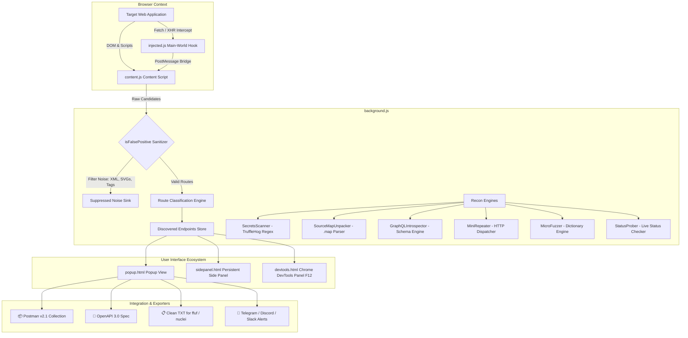

<p align="center">
  
</p>

<h1 align="center">Endpoint Hunter v8.0</h1>

<p align="center">
  <b>Enterprise API Reconnaissance &amp; Vulnerability Assessment Suite for Chromium Browsers (Manifest V3)</b><br>
  <i>Shannon Entropy • Stack Fingerprinter • Burp XML Exporter • CSP Bypass • Regex Lab • Cookie Auditor • Robots Parser • GraphQL Operations • Executive Summary • WS Mutator</i>
</p>

<p align="center">
  <a href="https://github.com/pratik-khairnar-sec/endpoint-finder-extension/releases"></a>
  <a href="manifest.json"></a>
  <a href="LICENSE"></a>
  <a href="#-manual-trigger-policy-zero-auto-scanning"></a>
  <a href="#-privacy--zero-tracking"></a>
</p>

<p align="center">
  <a href="#-overview"><b>Overview</b></a> •
  <a href="#-key-features"><b>Key Features</b></a> •
  <a href="#-architecture--pipeline"><b>Architecture</b></a> •
  <a href="#-reconnaissance-modules"><b>Recon Modules</b></a> •
  <a href="#-false-positive-suppression"><b>Noise Suppression</b></a> •
  <a href="#-comparison-matrix"><b>Comparison</b></a> •
  <a href="#-quick-start"><b>Installation</b></a> •
  <a href="#-security--ethics"><b>Ethics</b></a>
</p>

---

<p align="center">
  
</p>

---

## 📌 Overview

**Endpoint Hunter** is an enterprise-grade client-side reconnaissance and API discovery suite built specifically for **bug bounty hunters**, **penetration testers**, and **application security engineers**.

Modern Single Page Applications (React, Vue, Angular, Next.js, Nuxt) package hundreds of internal REST routes, administrative gateways, hidden microservices, WebSocket channels, and GraphQL schemas into minified JavaScript bundles. Manually finding these with proxy interceptors or grep CLI tools is noisy, slow, and full of false positives (XML schemas, broken HTML tags, SVG paths).

**Endpoint Hunter v8.0** runs directly inside Chromium browsers under **Manifest V3**. It expands your reconnaissance arsenal with mathematical information theory and industry interoperability: Shannon entropy calculation to unearth high-randomness cryptographic secrets, multi-layer technology stack fingerprinting (Express, Django, Rails, PHP, Spring, Next.js, Nuxt), Burp Suite Site Map XML exporting, CDN-based CSP bypass detection, custom regex extraction playground, cookie security hygiene auditing (`HttpOnly`, `SameSite`, `__Host-`), recursive robots.txt and sitemap parser, GraphQL mock operation synthesizers, and C-Suite **Markdown Executive Summary** reports.

---

## 🛑 Manual Trigger Policy (Zero Auto-Scanning)

> [!IMPORTANT]
> **Endpoint Hunter strictly enforces a ZERO auto-start policy.**
> - **No Background Spying**: The extension will **never** automatically scan, crawl, or sniff when you open or switch browser tabs.
> - **Explicit User Triggers**: Scans only begin when you explicitly click **`📡 SCAN (ALL)`**, **`🎯 SCAN CURRENT`**, or **`▶ START SNIFFER`**.
> - **Instant Emergency Stop**: Clicking **`⏹ STOP`** immediately halts all crawlers, probes, fuzzers, and network interceptors in real time.

---

## ⚡ Key Features

- **🎲 Shannon Entropy Calculation Lab**: Computes information theory entropy on 0.0 to 8.0 scale to identify leaked high-randomness credentials, crypto keys, and distinguish encrypted payloads from plain text.
- **🏗️ Multi-Layer Tech Stack Fingerprinter**: Identifies backend engines (Express.js, Django, Spring Boot, Ruby on Rails, PHP, ASP.NET) and modern frontend frameworks (Next.js, Nuxt, React, Angular) from headers, cookies, and structures.
- **📦 Burp Suite Target Site Map XML Exporter**: Serializes all discovered endpoints, methods, and status codes into standard Burp XML format (`burp_sitemap.xml`) for direct import into Burp Suite.
- **🛡️ CDN & JSONP CSP Bypass Evaluator**: Inspects `script-src` directives against cataloged CDN endpoints (`cdnjs`, `googleapis`, `jsdelivr`, `unpkg`) to flag potential CSP bypass risks.
- **🔍 Interactive Regex Playground**: Execute custom regular expressions against all crawled URLs, leaked secrets, and extracted paths in real time with group capture.
- **🍪 Deep Cookie Security Hygiene Auditor**: Audits cookies for `HttpOnly`, `Secure`, `SameSite`, and prefix hardening (`__Host-` / `__Secure-`).
- **🤖 Recursive Robots & Sitemap Harvester**: Recursively parses `/robots.txt` and `/sitemap.xml`, extracting `Disallow:` directives directly into the endpoint catalog.
- **🌸 GraphQL Mock Operation Mapper**: Automatically constructs executable GraphQL queries and mutations from introspected type schemas with synthetic argument values.
- **📝 Markdown Executive Summary Exporter**: Generates a professional bug bounty executive summary report in Markdown (`executive_summary.md`) with attack surface tables and remediation priorities.
- **🔌 WebSocket Payload Mutator**: In-browser JSON field tampering for active WebSocket message testing.
- **🎯 Server-Side Template Injection Prober**: Evaluates mathematical polyglots (`{{7*7}}`, `${7*7}`, `#{7*7}`, `<%= 7*7 %>`, `{{7*'7'}}`), confirming vulnerabilities only when backend template engines reflect computed outputs (`49` or `7777777`).
- **💉 SQL Injection Heuristic & Error Detector**: Probes parameters with single quote mutations, matching against error signatures for MySQL, PostgreSQL, SQLite, Oracle, and MSSQL with length delta analysis.
- **📜 XML External Entity Expansion Prober**: Formulates safe XML payloads with canary entity declarations to detect endpoints vulnerable to XML entity expansion.
- **☣️ Prototype Pollution Scanner**: Injects prototype pollution parameter patterns and monitors `Object.prototype.eh_polluted` in the browser runtime to verify client-side pollution.
- **📊 Attack Surface Changelog & Route Diff**: Saves scan snapshots and computes attack surface deltas, highlighting newly exposed routes (`+ NEW`), removed routes (`- REMOVED`), and status changes.
- **📖 Contextual Recon Wordlist Builder**: Extracts path tokens, filenames, and parameters into a clean, deduplicated wordlist (`wordlist.txt`) paired with sensitive backup extensions (`.json`, `.env`, `.bak`, `.sql`).
- **🌸 Client-Side Template Injection Auditor**: Detects AngularJS, Vue.js, and Alpine.js in page DOM and provides tailored CSTI sandbox bypass vectors.
- **🌐 SSRF Parameter Harvester & Payloads**: Discovers URL-carrying query parameters and provides standard internal loopback (`127.0.0.1`) and cloud metadata (`169.254.169.254`) test payloads.
- **⚡ Multi-Worker High-Concurrency Status Prober**: 8-thread concurrent worker pool probing hundreds of endpoints simultaneously without UI latency.
- **🧬 Automated Nuclei Template Exporter**: Generates standard Nuclei YAML templates (`recon_nuclei_template.yaml`) targeting discovered endpoints with status matchers.
- **🌐 Subdomain Takeover Analyzer**: Checks external domains against dangling CNAME signatures for 10 cloud services (GitHub Pages, AWS S3, Heroku, Fastly, Shopify, Tumblr, WordPress, Ghost, Bitbucket, Surge.sh).
- **💥 Client-Side DOM XSS Taint Auditor**: Scans inline scripts and reflected parameters for source-to-sink taint paths (`location.hash/search` into `innerHTML`, `document.write`, `eval`).
- **🛡️ Multi-Vendor WAF Fingerprinter**: Identifies Cloudflare, AWS WAF, Akamai, Imperva Incapsula, Fastly, ModSecurity, F5 BIG-IP, and Sucuri from headers and error pages.
- **🧪 Unkeyed Cache Poisoning Prober**: Injects unkeyed headers (`X-Forwarded-Host`, `X-Host`, `X-Original-URL`, `X-Rewrite-URL`) to detect dangerous cache reflections.
- **↪️ Open Redirect Probe Engine**: Scans 18 common redirect parameters and checks for reflection in HTTP 301/302 `Location` headers.
- **🔑 OAuth 2.0 & OpenID Flow Auditor**: Validates `state` parameter presence, warns against deprecated implicit grant (`token`), and flags plaintext HTTP redirect URIs.
- **🌸 Advanced GraphQL Exploration**: Probes for array batching support (brute force & DoS risk) and error-based field suggestions to map schemas without introspection.
- **🕵️ Automated Recon Dork Generator**: 1-click tailored GitHub and Google dorks searching for leaked `.env` files, RSA keys, internal routes, and database dumps.
- **⏱️ Rate Limit Concurrency Burst Analyzer**: Executes rapid 6x burst requests to check `X-RateLimit-*`, `Retry-After`, and HTTP 429 throttling thresholds.
- **📄 Standalone Interactive HTML Report**: Exports `recon_report.html` with Obsidian Cyberpunk styling, summary cards, and responsive data tables.
- **🌐 Active CORS Origin Reflection Auditor**: Probes preflight OPTIONS and GET requests with arbitrary attacker origins (`https://evil-attacker.com`) and `null` origins, detecting dangerous `Access-Control-Allow-Credentials: true` combinations with instant reproducible `curl` commands.
- **🔑 Dual-Pane JWT Inspector & Attack Generator**: Decodes header and payload in real time, audits for weak algorithms and expired tokens (`exp`), and generates ready-to-test `Alg: None` bypass tokens.
- **📊 Security Headers Analyzer & Letter Grade**: Evaluates CSP, HSTS, X-Frame-Options, X-Content-Type-Options, Referrer-Policy, and Permissions-Policy, calculating a letter grade (A+ to F) and providing hardening recommendations.
- **📜 Live Swagger 2.0 & OpenAPI 3.0 Spec Importer**: Ingests live API docs URLs or pasted JSON, automatically importing paths, HTTP methods, parameters, and tags directly into the database.
- **🗄️ Runtime Storage & Cookie Security Auditor**: Audits `localStorage`, `sessionStorage`, and readable cookies for sensitive credentials, JWTs, and cookies missing the `HttpOnly` security flag.
- **💳 PII Data Leakage Detector**: Scans response bodies using the Luhn algorithm for valid Credit Cards (Visa, MC, Amex, Discover), US SSNs, and email addresses with masked previews.
- **⚡ HTTP Verb Tampering Matrix**: 1-click test of 7 HTTP verbs (`GET`, `POST`, `PUT`, `DELETE`, `PATCH`, `HEAD`, `OPTIONS`) to detect authentication bypasses where GET returns 401/403 but alternative verbs return 200/204.
- **🎯 Numeric IDOR Differential Sequencer**: Detects numeric IDs in paths or parameters, sequentially testing neighboring records and flagging differential response length anomalies.
- **☁️ Multi-Cloud Storage Bucket Harvester**: Detects AWS S3, Google Cloud Storage, and Azure Blob storage buckets in source code and traffic, with 1-click public listable and read accessibility checks.
- **🐚 Executable Recon Bash Script Exporter**: Exports `recon_audit.sh` with ANSI terminal colors, automated rate-limiting loops, and authorization headers.
- **🔌 Real-Time WebSocket & SSE Interceptor**: In-browser frame capture of `window.WebSocket` (`send`/`message`) and `window.EventSource` streams with direction markers and formatted payload previews.
- **🔍 In-Browser Parameter Miner (Arjun-style)**: Active probe engine testing top 30 sensitive query parameters against response length and status code baselines, with 1-click injection into the Mini-Repeater.
- **🤖 SPA Headless DOM Walker**: Safely fires synthetic user interactions across non-destructive navigation tabs, accordions, and dropdowns to trigger hidden lazy-loaded API calls.
- **📦 Standard HTTP Archive (HAR 1.2) Exporter**: 1-click export of captured traffic in standard HAR 1.2 format for direct drag-and-drop import into **Burp Suite**, **Caido**, and **Postman**.
- **🧪 In-Browser Mini-Repeater**: Burp Suite & Postman style HTTP request dispatcher. Edit HTTP method (`GET`, `POST`, `PUT`, `DELETE`, `PATCH`, `HEAD`, `OPTIONS`), headers, and body with live latency measurement and pretty-printed JSON response viewer.
- **🌸 GraphQL Schema Introspector**: Sends standard `IntrospectionQuery` to `/graphql` endpoints, maps out all Queries, Mutations, Types, and arguments, and generates 1-click test templates for the Mini-Repeater.
- **🗺️ Source-Map (`.map`) Route Unpacker**: Reconstructs original TypeScript and JavaScript source files from `.map` files, unearthing internal routes and API definitions stripped from production bundles.
- **🔑 Client-Side Secrets & Token Harvester**: High-precision TruffleHog-style detection of leaked AWS keys, Google API keys, GitHub PATs, Stripe tokens, Slack/Discord webhooks, OpenAI keys, and JWTs.
- **🕷️ Micro-Fuzzer & Route Dictionary**: Rapidly checks target base URLs for high-value unlinked assets: Swagger/OpenAPI docs, Spring Boot Actuators, Admin consoles, `.env` files, and `.git/HEAD` leaks with stealth delays.
- **⚡ Passive Runtime Network Sniffer**: Main-world injected hook non-intrusively captures real fetch and XHR calls made as you interact with the target application.
- **🎯 Live Status Prober & Security Triage**: Batch-probes discovered endpoints to tag `200 OK`, `401/403 Protected`, and `500 Error`. Heuristically flags query parameters prone to `SSRF`, `IDOR`, and `LFI`.
- **🛠️ Chrome DevTools (F12) & Side Panel**: Open Endpoint Hunter in the Chrome Side Panel or as a native Developer Tools panel right next to Network and Console.
- **📦 Multi-Format Exporters**: 1-click export to **Postman Collection v2.1**, **OpenAPI 3.0 Specification**, **Clean TXT** (for `ffuf`, `nuclei`, `katana`), **JSON**, and printable **PDF**.
- **📢 Tri-Platform Webhook Alerts**: Configurable notifications dispatched to **Telegram**, **Discord**, or **Slack** when sensitive credentials or admin portals are uncovered.

---

## 🔬 Architecture & Pipeline



---

## 🧰 Reconnaissance Modules

### 1. In-Browser Mini-Repeater
Test APIs immediately inside your workflow without switching to external software:
- **Methods**: `GET`, `POST`, `PUT`, `DELETE`, `PATCH`, `HEAD`, `OPTIONS`.
- **Headers**: Custom header input automatically merged with **Global Auth** (Bearer token, Session cookies, API keys).
- **Body**: Raw or JSON request body payload editor.
- **Inspector**: High-resolution latency timer (`ms`), response size (`bytes`), status badge (`200 OK`, `401 AUTH`, `500 ERR`), and 1-click response copy.

### 2. GraphQL Schema Introspector
Discover the entire backend API surface hidden behind a single `/graphql` endpoint:
- Executes standard `IntrospectionQuery`.
- Parses all available **Queries** and **Mutations** with argument names, types, and return values.
- Synthesizes ready-to-test GraphQL query templates.
- Features a direct **"Test in Repeater"** button for instant payload execution.

### 3. Source-Map (`.map`) Route Unpacker
Modern build tools (Webpack, Vite, Rollup) often deploy source maps alongside minified code:
- Fetches and parses `.map` JSON data.
- Extracts the original file tree (`sources`), identifying controllers, services, and API handlers.
- Scans `sourcesContent` for internal API routes, query strings, and environment secrets that were stripped from the production bundle.

### 4. Client-Side Secrets Harvester
Scans all scripts, inline code, and DOM content using high-entropy regex patterns:
- **AWS**: Access Key IDs (`AKIA...`).
- **Google**: API Keys (`AIza...`).
- **GitHub**: Personal Access Tokens (`ghp_...`, `github_pat_...`).
- **Stripe**: Live & Test Secret Keys (`sk_live_...`, `pk_live_...`).
- **Webhooks**: Discord & Slack webhook URLs.
- **OpenAI**: API Keys (`sk-proj-...`, `sk-...`).
- **JWT**: Web Tokens (`eyJ...`).
- **Environment**: Exposed `NEXT_PUBLIC_*`, `REACT_APP_*`, `VITE_*` configuration keys.

### 5. Micro-Fuzzer & Sensitive Dictionary
Target an origin with high-confidence, non-destructive path checks:
- **API Docs**: `/swagger.json`, `/openapi.json`, `/v2/api-docs`, `/api-docs`, `/swagger-ui.html`.
- **Actuators**: `/actuator`, `/actuator/health`, `/actuator/env`, `/actuator/metrics`, `/health`, `/metrics`.
- **Admin**: `/admin`, `/administrator`, `/console`, `/dashboard`, `/internal`, `/management`.
- **Configs**: `/.env`, `/.git/HEAD`, `/config.json`, `/.well-known/security.txt`, `/robots.txt`.
- **GraphQL**: `/graphql`, `/graphiql`, `/altair`, `/playground`, `/debug`.

---

## 🚫 False Positive Suppression

Typical regex scrapers flood researchers with non-actionable junk strings. Endpoint Hunter actively discards invalid strings using AST heuristics:

| Scraped Candidate | Standard Scraper | Endpoint Hunter v3.0 | Heuristic Reason |
| :--- | :---: | :---: | :--- |
| `http://www.w3.org/2000/svg` | ❌ Flagged as URL | **DROPPED** | W3C / SVG Schema Namespace |
| `https://schemas.microsoft.com/...` | ❌ Flagged as URL | **DROPPED** | Microsoft XML metadata schema |
| `/div>` or `/span>` | ❌ Flagged as Route | **DROPPED** | HTML closing tag fragment |
| `/${path}/endpoint` | ❌ Broken Route | **DROPPED** | Unresolved template literal |
| `/node_modules/lodash/debounce.js` | ❌ Flagged as Route | **DROPPED** | Vendor bundle internal artifact |
| `javascript:void(0)` | ❌ Flagged as Route | **DROPPED** | Pseudo-protocol URI |
| `/api/v2/auth/token` | ✔️ Valid Endpoint | **KEPT (AUTH)** | Actionable API route |
| `/admin/users/export` | ✔️ Valid Endpoint | **KEPT (ADMIN)** | Actionable administrative route |

---

## 📊 Comparison Matrix

| Capability | Endpoint Hunter v4.0 | Burp Suite JS Miner | Postman | Katana / LinkFinder |
| :--- | :---: | :---: | :---: | :---: |
| **In-Browser Execution** | **YES (MV3 Extension)** | Requires Desktop Proxy | Desktop App | CLI Only |
| **Zero Auto-Scan Invariant** | **YES (100% Manual)** | Depends on scope | Manual | Manual |
| **WebSocket & SSE Interceptor** | **YES (Live Frame Feed)** | Burp Proxy WS | Limited | NO |
| **In-Browser Parameter Miner** | **YES (Differential)** | Param Miner Extension | NO | Arjun (CLI) |
| **SPA Headless DOM Walker** | **YES (Safe Clicker)** | Burp Spider | NO | Katana Headless |
| **Standard HAR 1.2 Export** | **YES (1-Click)** | XML Export | HAR Export | NO |
| **In-Browser Mini-Repeater** | **YES (Built-In)** | Separate Tool (Repeater) | YES | NO |
| **GraphQL Introspector** | **YES (Auto-Templates)** | Requires Plugin | Manual | NO |
| **Source-Map (.map) Unpacker** | **YES (Tree + Routes)** | Basic | NO | Requires separate tool |
| **TruffleHog Secrets Hunter** | **YES (Multi-Provider)** | Basic Secrets | NO | Separate CLI |
| **Micro-Fuzzer Dictionary** | **YES (Non-destructive)** | Intrude-heavy | Collection Runner | CLI / ffuf |
| **Chrome Side Panel & DevTools** | **YES (SidePanel + F12)** | NO | NO | NO |
| **Postman / OpenAPI Export** | **YES (1-Click)** | Plugin dependent | Native | NO |
| **100% Offline Privacy** | **YES (Zero Telemetry)** | Local | Cloud Account | Local |

---

## 🚀 Quick Start & Installation

### Step 1: Clone the Repository

```bash
git clone https://github.com/pratik-khairnar-sec/endpoint-finder-extension.git
```

### Step 2: Enable Developer Mode in Chromium

1. Open **Google Chrome**, **Brave**, or **Microsoft Edge**.
2. Navigate to `chrome://extensions` in your address bar.
3. In the top-right corner, toggle **Developer mode** to `ON`.

### Step 3: Load Unpacked Extension

1. Click the **Load unpacked** button in the top-left corner.
2. Select the cloned `endpoint-finder-extension` folder.
3. The **Endpoint Hunter** radar icon will appear in your browser toolbar!

### Step 4: Access DevTools Panel or Side Panel

- **Chrome Side Panel**: Click the extension icon and click **`🪟 SIDE PANEL`** to keep the tool pinned side-by-side with your browsing.
- **Chrome DevTools**: Press `F12` (or Right-Click -> *Inspect*), and switch to the **Endpoint Hunter** tab.

---

## 🔒 Security & Privacy Guarantees

- **100% Local Execution**: All extraction, pattern matching, source map unpacking, and secret hunting occurs strictly in your browser.
- **Zero Telemetry**: No Google Analytics, no tracking pixels, and no remote servers.
- **Hardened CSP**: Extension pages enforce a strict Content Security Policy (`script-src 'self'`).
- **Safe DOM Rendering**: All scraped data is escaped prior to insertion into the DOM to eliminate DOM-based XSS risks.

---

## 👤 Author

**Pratik Khairnar**
- GitHub: [@pratik-khairnar-sec](https://github.com/pratik-khairnar-sec)
- Bug Bounty Hunting, Application Security & Open-Source Reconnaissance Tooling

---

## 📄 License & Ethics

This project is licensed under the **MIT License** — see the [LICENSE](LICENSE) file for details.

> [!CAUTION]
> **Endpoint Hunter is designed for authorized security assessments, penetration testing, and bug bounty programs only.**  
> Always obtain explicit authorization before probing, repeating, or fuzzing targets that you do not own.
